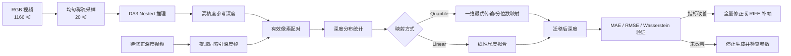

# 深度估计与修正工作周报（2026.08.17—2026.08.21）

## 一、本周工作总结

本周完成了深度估计结果的统计与修正流程开发。使用 DA3 Nested 模型生成稀疏高精度参考深度，新增深度分布统计、分位数映射、线性映射及迁移前后指标验证能力，并预留全量视频修正与 RIFE 时间轴补帧流程。

目前已在 `cam_front_head / episode_000000` 上完成阶段性验证：从 1166 帧视频中均匀选取 20 帧，共统计 8,140,800 个有效像素。分位数映射后，MAE 由 215.84 mm 降至 53.00 mm，RMSE 由 255.23 mm 降至 87.12 mm，Wasserstein-1 距离由 213.87 mm 降至 0.11 mm，整体深度尺度与 Nested 参考分布基本对齐。

## 1. DA3 Nested 稀疏高精度参考深度生成

### 1.1 整体流程

**图1 DA3 Nested 稀疏深度生成与映射流程**

### 1.2 深度分布统计

本次参考深度由 `depth-anything/DA3NESTED-GIANT-LARGE-1.1` 生成。20 个采样帧的有效深度范围为 147.56～2307.35 mm，均值为 867.59 mm，标准差为 496.23 mm；P10、P50、P90 分别为 457.37 mm、665.64 mm 和 1784.22 mm。

**图2 DA3 Nested 参考深度示例（第 613 帧）**

| 统计项 | 数值 |
| --- | ---: |
| 采样帧数 | 20 |
| 有效像素数 | 8,140,800 |
| 最小深度 | 147.56 mm |
| 最大深度 | 2307.35 mm |
| 平均深度 | 867.59 mm |
| 标准差 | 496.23 mm |
| P10 | 457.37 mm |
| P50 | 665.64 mm |
| P90 | 1784.22 mm |

### 1.3 分位数映射

本周重点验证 Quantile Mapping。该方法分别计算源深度与 Nested 参考深度的等概率分位点，并通过一维插值将源深度映射到参考分布。与单一比例缩放相比，该方法能够修正非线性的尺度偏差，并保持原深度图中的像素空间结构。

**图3 Quantile Mapping 前后深度均值与 Wasserstein-1 距离对比**

### 1.4 指标验证

| 指标 | 映射前 | 映射后 | Nested 参考 |
| --- | ---: | ---: | ---: |
| Mean | 1081.45 mm | 867.48 mm | 867.59 mm |
| Median / P50 | 805 mm | 666 mm | 665.64 mm |
| P10 | 606 mm | 457 mm | 457.37 mm |
| P90 | 2211 mm | 1784 mm | 1784.22 mm |
| Mean Error | 213.86 mm | -0.11 mm | 0 mm |
| MAE | 215.84 mm | 53.00 mm | 0 mm |
| RMSE | 255.23 mm | 87.12 mm | 0 mm |
| Wasserstein-1 | 213.87 mm | 0.11 mm | 0 mm |

验证结果表明，映射后的全局分布已与 Nested 参考深度高度一致，MAE 降低约 75.4%，RMSE 降低约 65.9%。但 MAE 和 RMSE 仍明显高于零，说明全局分布对齐不能完全消除逐像素局部误差。

## 二、存在问题

1. 当前结果仅覆盖头部相机的单个 Episode，样本范围有限，尚不能代表全部相机和任务场景。
2. 分位数映射主要校正全局深度尺度与分布，不会直接修复物体边缘、遮挡区域及局部几何误差。
3. 当前处于 `validate` 阶段，尚未生成全量修正视频；RIFE 补帧后的时序稳定性和快速运动区域质量仍待验证。
4. 需要继续检查 RGB 与深度视频帧数、采样索引及编码后的数值精度，防止出现时间轴错位或二次量化误差。

## 三、下周计划

1. 扩展至多相机、多 Episode 批量验证，汇总不同场景下的 MAE、RMSE 和 Wasserstein-1 改善幅度。
2. 完成 `full` 阶段全量深度映射，检查输出视频帧数、深度范围及 12-bit H.265 编码误差。
3. 开展 RIFE 时间轴补帧测试，重点评估快速运动、遮挡变化和物体边缘处的时序一致性。
4. 对比分位数映射与线性映射的精度和泛化能力，确定适用于批量数据处理的默认参数。
5. 补充异常 Episode 处理、批量统计汇总及结果可视化，形成可复现的深度修正流程。

> 数据来源：`depth_statistics/cam_front_head/episode_000000/statistics.json` 与 `refine_parameters.json`。本报告结论仅针对当前阶段性验证数据。
